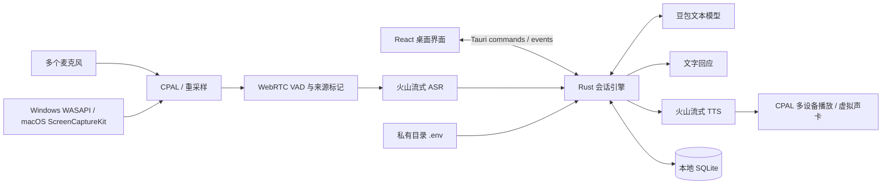

# Vibesetter 项目总览

## 架构与技术选择

Tauri 2 提供 Rust 桌面宿主和平台 WebView；React / TypeScript / Vite 提供 UTF-8 中文界面。Rust 负责凭据、本地 SQLite、设备与音频、云服务和会话调度。无自建服务、账户系统、云端同步、原始音频存储或内置虚拟声卡驱动。

音频统一为 16 kHz 单声道 PCM16 分来源上传识别，每包约 200 ms；静音时补零维持识别连接，错误来源独立取消。合成使用 24 kHz PCM16，再重采样到各播放设备。采用 Rubato FFT 重采样和 WebRTC VAD，不自行实现算法。系统音频通过 Windows 进程树排除模式和 macOS `excludesCurrentProcessAudio` 防止采集自身输出。多来源授权期间丢弃启动前音频，全部就绪后才开始收集。

## 会话行为

- 同时一个会话，状态为 stopped / listening / thinking / speaking。输入至少一种，输出至少一种，音频设备不能重复选择。
- 输入包括多个麦克风、一路系统音频和文字；输出设备收到同一份语音，文字与语音共享回复。
- 确定转写按时间入库；非确定转写仅实时显示。来源标签表示设备，不承诺说话人分离。
- 会话默认自动判断。仅文字输出收到新的完整转写即可判断，不要求讲话停顿；包含语音输出（含文字 + 语音）时等待约 1.2 秒停顿，文字和语音共享回复。自动请求间隔至少 4 秒，模型按提示词判断是否值得回应；手动提交或“回应一次”立即触发。
- 文字建议生成期间继续收集新转写，不因人声取消；新增内容在当前请求结束后按间隔继续判断，每次至多一个有效生成任务。模型决定不回应或请求失败后，不针对相同内容自动重试；出现新完整转写后再判断。
- 最近 40 条、最多 24,000 字的会话内容提供上下文，超出后舍弃最旧内容。提示词保留，不进行摘要请求。
- 包含语音输出时，有效人声持续约 400 ms 可取消当前生成或播放，并保留上下文等待下一次停顿；generation 标识拦截迟到结果。立即停止取消生成、合成、播放缓冲与待处理判断，收到新完整转写、手动提交或手动要求回应后才能再次回应。
- 播放状态等待缓冲耗尽再结束；某个输出断开时其他输出继续。来源错误提供具体提示，暂停再开始恢复连接。
- 暂停终止当前会话；再次开始创建新会话。历史不自动注入新会话。

## 桌面 API

Tauri IPC，不提供本地 HTTP 服务。应用命令只向主窗口开放。参数使用 JavaScript camelCase；数据结构字段为 snake_case。

| 命令 | 请求参数 | 返回 / 行为 |
| --- | --- | --- |
| `list_assistants` | 无 | `Assistant[]` |
| `save_assistant` | `assistant` | 校验并返回保存后的助手；新助手 id 为空 |
| `delete_assistant` | `id` | 级联删除助手、路由与历史；活动助手须先暂停 |
| `get_settings` | 无 | 非敏感设置与凭据存在标志 |
| `save_settings` | `patch` | 原子保存 `.env`；缺省字段保持，显式空字符串清除 |
| `test_connection` | `service`: text/asr/tts | 实际连接检测结果，不播放检测音频 |
| `list_devices` | 无 | 带稳定设备 ID、类型、名称、默认标志的设备列表 |
| `get_route` / `save_route` | `id` / `id, config` | 每助手的多选路由；活动会话不可更改 |
| `start_session` | `assistantId, config` | 预检并创建 `Session` |
| `stop_session` | 无 | 取消采集与请求、关闭会话 |
| `submit_text` | `text` | 提交手动文本，要求启用文字输入 |
| `trigger_reply` / `interrupt_reply` | 无 | 强制回应 / 停止当前回应 |
| `list_sessions` | `assistantId` | 最近 100 次会话 |
| `list_messages` | `sessionId` | 会话文字记录 |
| `delete_session` | `sessionId` | 删除非活动会话与消息 |

统一事件 `session-event`，使用 `type` 判别：`status`、`auto_reply`、`transcript`、`message`、`level`、`interrupted`、`error`。包含 session_id（消息事件位于 message 中），界面过滤过期会话。消息的 `visible` 控制当前会话是否展示助手文字；音频模式仍保存文字历史。凭据不会出现在事件或错误响应中。

`auto_reply` 的结构为 `{type:"auto_reply",session_id,state}`。`state` 为 `listening`、`waiting_for_pause`、`waiting_for_interval`、`evaluating`、`skipped`、`interrupted` 或 `error`；只在状态变化时发送，用于解释自动判断过程，不写入会话消息或数据库。无需新增配置或迁移已有数据。

外部文本 API 为方舟兼容的 `/chat/completions`，Bearer 鉴权；内部要求 JSON `{respond:boolean,text:string}`，以支持主动倾听。ASR 使用火山 v3 WebSocket 二进制协议，支持 gzip、序列号和确定语句去重；TTS 支持 v3 HTTP Chunked JSON / SSE。语音支持新版 `X-Api-Key`；旧版 ASR 使用 `X-Api-App-Key`，HTTP TTS 使用 `X-Api-App-Id`，配合 `X-Api-Access-Key`，两者请求标识分别为 Connect ID / Request ID。返回错误只展示状态码与操作提示。

## 数据与凭据

| 表 | 主要字段 | 关系与索引 |
| --- | --- | --- |
| assistants | id、data（名称、提示词、头像 PNG data URI、颜色、时间） | 主键 id |
| sessions | id、assistant_id、started_at、ended_at | 助手外键级联；assistant_id + started_at 索引 |
| messages | id、session_id、role、source、text、created_at、interrupted | 会话外键级联；session_id + created_at 索引 |
| routes | assistant_id、data（输入输出配置） | 助手外键级联 |

SQLite 使用 UTF-8、WAL、外键约束。头像上传后浏览器裁切为 256×256 PNG，随助手存入本地数据库。启动时关闭上次异常退出留下的活动会话。首版建表幂等，后续结构变更需增加显式版本迁移。

生产位置由 Tauri `app_data_dir()` 确定，包含 `vibesetter.db` 和 `.env`。Unix 目录权限 0700、凭据与数据库 0600；Windows 继承当前用户 AppData 目录访问控制。文件中的凭据不加密，面向本机账户隔离；不要把应用数据目录作为共享目录。`.env` 写入采用同目录临时文件、sync、rename，解析不展开环境变量。密钥仅由 Rust 持有；界面返回存在标志，浏览器预览不保存或使用凭据。

`.env` 字段与 `.env.example` 对应，另支持 `SPEECH_API_KEY`（新版语音控制台）。不自动导入仓库开发配置；避免不同应用目录间误用凭据。

## 构建与验证边界

Windows 使用原生 MSVC 构建 NSIS；Mac 使用 Rust arm64 和 Swift 工具链构建 DMG。GitHub Actions 上传构建产物，不触发公开发布。发行签名、公证、商店上架不包含在首版。

本地测试使用模拟 HTTP、WebSocket 和音频端，不使用真实凭据。Linux 可以验证核心、界面、桌面编译以及 Windows 交叉类型检查；硬件采集、回声、授权、安装与实际服务延迟必须在两种目标系统验收。约 2–5 秒文字响应是目标，不能仅凭模拟服务测试宣称达成。

## 仓库与维护文档

代码仓库为 [dolphinfafa/vibesetter](https://github.com/dolphinfafa/vibesetter)，主分支 `main`。推送触发 `.github/workflows/check.yml`：先执行前端与 Rust 核心检查，再生成 Windows NSIS 和 Apple Silicon Mac DMG，产物位于对应工作流运行的 Artifacts 中。代码同步、工作流构建通过和真机验收分别记录。

Agent 开始工作前阅读 [项目指引](.agent/workflows/project-index.md)；目标平台检查使用 [验收清单](.agent/workflows/platform-validation.md)；每日维护 `milestone/YYYY-MM-DD.md`。[2026-11-04](milestone/2026-11-04.md) 记录首版实现，[2026-11-24](milestone/2026-11-24.md) 记录文档整理、回归验证与首次 GitHub 同步。
